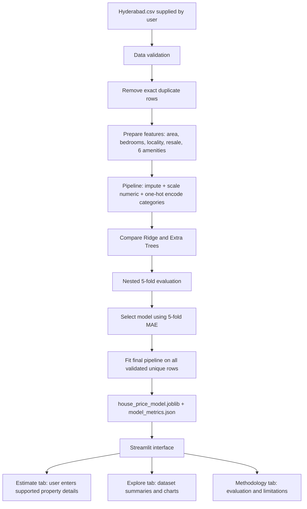

# Project architecture and user flow

## Architecture

## User flow

1. The user opens the app and chooses a Hyderabad locality from the source data.
2. The user enters area in square feet, bedrooms, and new/resale status. Amenities are optional; “Not specified” is distinct from “No.”
3. The saved scikit-learn pipeline predicts one property-price point estimate from those fields.
4. The app shows the held-out cross-validation MAE as a dataset-level error measure, alongside clear warnings about time, data coverage, and absent fields.
5. The user can explore dataset summaries and read how validation, model choice, and limitations work.

## Data and modeling decisions

- The uploaded Hyderabad-only CSV is preserved as `Hyderabad.csv`.
- Exact duplicate rows are removed before cross-validation and final fitting.
- Invalid core values (missing/non-numeric/non-finite prices, area, bedrooms, or status; non-positive price/area/bedrooms; invalid resale code) are excluded and counted.
- The estimator uses area, locality, bedrooms, resale status, and six selected amenities. It does not use bathrooms or PIN code because neither column exists in the supplied data.
- The source has 0/1/9 amenity codes. Code 9 remains a distinct “Not specified” category.
- A log transformation is used for the skewed price target, with predictions transformed back to the source price scale.
- Nested 5-fold CV estimates performance after choosing between Ridge and Extra Trees within each outer training fold. A median-price baseline is reported for context.
- No confidence interval or per-property error range is produced.

## Stack and languages

- **Python 3.11–3.13:** application and model code.
- **Streamlit:** local interactive web interface.
- **pandas / NumPy:** CSV loading, validation, and data preparation.
- **scikit-learn:** preprocessing pipelines, regression models, cross-validation, and metrics.
- **joblib:** save/load the fitted pipeline.
- **Plotly Express:** interactive charts.
- **Markdown:** project documentation.
- **HTML/CSS:** small embedded style layer for the white, professional interface.

The interface runs locally. It does not send property inputs to a server or call a live property API.
